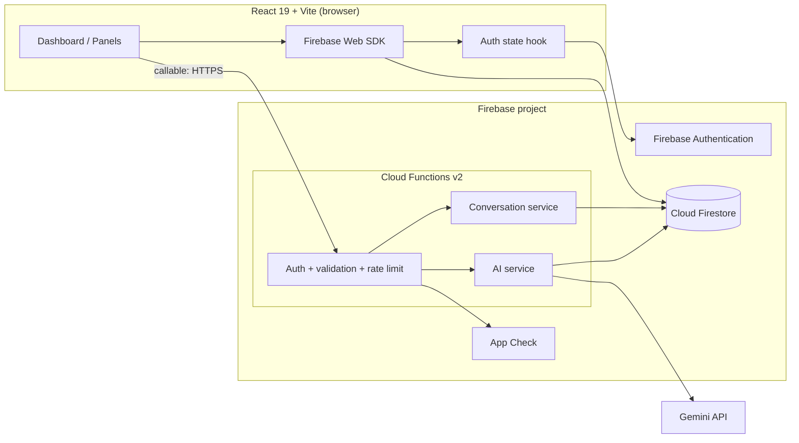
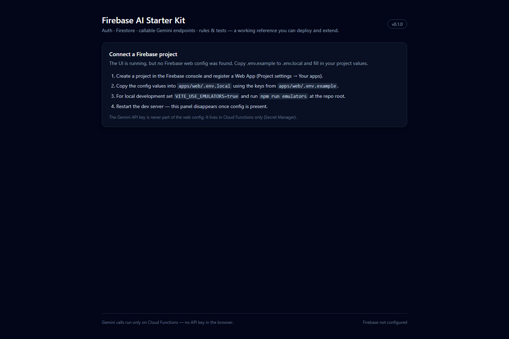
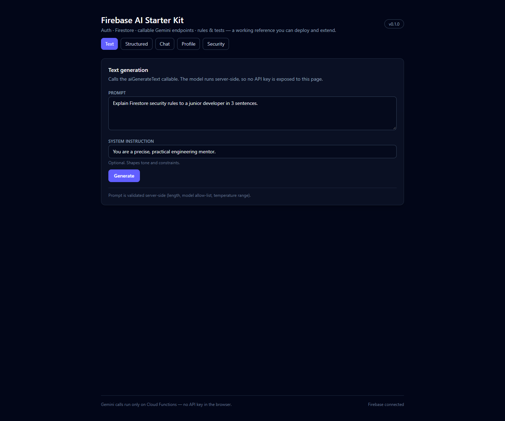
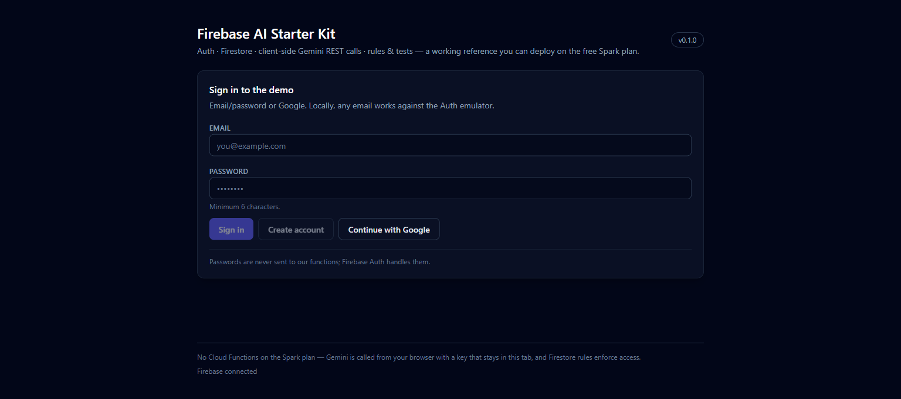
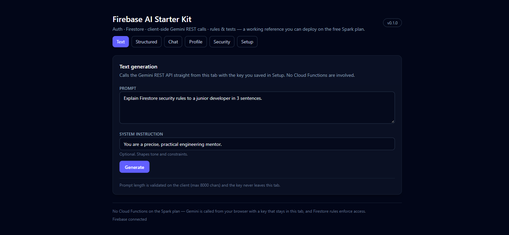
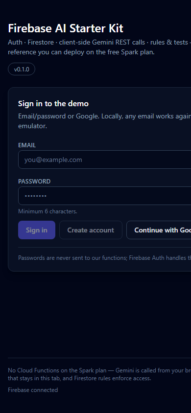

# Firebase AI Starter Kit

[](https://github.com/hamids-ai-automations/firebase-ai-starter-kit/actions/workflows/ci.yml)
[](LICENSE)
[](package.json)

A production-minded starter kit for building **Gemini AI features on Firebase** — real authentication,
owner-scoped Firestore rules, strict validation, an emulator-first workflow, and a working React demo
instead of a snippet collection.

It ships in two interchangeable deployment modes. The default build targets the **free Spark plan**;
the same endpoints also exist as server-side Cloud Functions for teams that want the key off the client.

| Mode                                   | Gemini calls run                                                   | Billing             | Status                                                    |
| -------------------------------------- | ------------------------------------------------------------------ | ------------------- | --------------------------------------------------------- |
| **Spark mode** (default build)         | In the browser via REST, using the signed-in user's own API key     | None — no Blaze     | **Live:** <https://fb-ai-starter-kit.web.app>              |
| **Blaze mode** (`functions/` variant)  | Inside Cloud Functions 2nd gen, key held as a server-only secret    | Blaze plan required | Reference implementation, deployed on demand               |

- **Live demo (Spark):** <https://fb-ai-starter-kit.web.app>
- **Project page:** <https://marvis.web.app/projects/firebase-ai-starter-kit>
- **Spark deployment guide:** [`docs/FREE_PLAN_DEPLOYMENT.md`](docs/FREE_PLAN_DEPLOYMENT.md)
- **Documentation:** [`docs/`](docs/) — architecture, setup, API reference, security, testing, deployment

---

## Table of contents

1. [Project introduction](#1-project-introduction)
2. [Problem statement](#2-problem-statement)
3. [Key features](#3-key-features)
4. [Architecture](#4-architecture)
5. [Technology stack](#5-technology-stack)
6. [Screenshots](#6-screenshots)
7. [Prerequisites](#7-prerequisites)
8. [Installation](#8-installation)
9. [Firebase configuration](#9-firebase-configuration)
10. [Gemini configuration](#10-gemini-configuration)
11. [Environment variables](#11-environment-variables)
12. [Local development](#12-local-development)
13. [Authentication guide](#13-authentication-guide)
14. [Firestore guide](#14-firestore-guide)
15. [Gemini integration guide](#15-gemini-integration-guide)
16. [Cloud Functions guide](#16-cloud-functions-guide)
17. [Security documentation](#17-security-documentation)
18. [Testing](#18-testing)
19. [Deployment](#19-deployment)
20. [Troubleshooting](#20-troubleshooting)
21. [Contributing](#21-contributing)
22. [License](#22-license)
23. [Roadmap](#23-roadmap)
24. [Project links](#24-project-links)

---

## 1. Project introduction

Most "AI + Firebase" samples skip Firestore rules, trust the client to police its own data, and stop
at a single prototype file. This kit is built around the parts that decide whether an AI feature
survives real users: **who may read a document, what happens when the model returns malformed JSON,
where the API key lives, and how any of it is tested before production.**

The kit deliberately implements the same product through two back ends:

- **Spark mode** — the browser calls Gemini REST directly with a key the user supplies in the Setup
  tab. The key lives in `sessionStorage` for that tab only: never committed, never bundled, never
  written to Firestore. This mode needs no billing account, and it is what runs at
  <https://fb-ai-starter-kit.web.app>.
- **Blaze mode** — the same endpoints as Cloud Functions 2nd gen: Zod validation, per-user rate
  limits, server-only `GEMINI_API_KEY`, conversation persistence. Kept in `functions/` as the
  production upgrade path.

Both modes share one contract (`apps/web/src/lib/api.ts` keeps the original callable-shaped function
names), so switching modes is a configuration change, not a rewrite.

## 2. Problem statement

Building an AI feature on Firebase usually raises the same five problems:

| Problem                  | Typical shortcut                                     | What this kit does                                                                         |
| ------------------------ | ---------------------------------------------------- | ------------------------------------------------------------------------------------------ |
| API key exposure         | Key inlined into the production bundle               | Spark mode: user-supplied key kept in `sessionStorage` only. Blaze mode: server-only secret  |
| Unbounded cost           | No limits on prompt size, history, or call frequency | Zod length caps, message-history caps, Firestore-backed per-user rate limits               |
| Data leakage             | Shared collection with client-side filtering         | `users/{uid}/**` ownership rules, enforced and unit-tested                                 |
| Unvalidated model output | Raw JSON parsed in the UI                            | Schema-constrained structured output validated before it reaches React                     |
| Untestable setup         | Manual clicking through the console                  | Emulator Suite, mocked model, 51 unit tests, 22 rules tests, 14 end-to-end emulator checks |

## 3. Key features

**Authentication**

- Email/password sign-up, sign-in, password reset, session persistence, sign-out.
- Profile bootstrap on first login (`ensureUserProfile`) and profile updates with validated preferences.

**Firestore**

- Per-user profile, preferences, conversations, messages, and monthly usage counters.
- Security rules covering read/write separation, ownership, immutability of server-managed fields.

**Gemini**

- Server-side text generation, chat with history, and schema-constrained structured output.
- Mock mode for emulator/CI runs so tests never bill the API.

**Cloud Functions (2nd gen, TypeScript)**

- Nine callable endpoints with shared middleware: auth, App Check awareness, validation, rate
  limiting, structured error mapping, and request logging.

**Security**

- App Check integration points, strict schemas, rate limits, redacted logging, secret scanning
  script, hardened hosting headers, and a documented threat model.

**Developer experience**

- One-command emulator flow, mock AI mode, type-checking, linting, formatting, secret scanning,
  rules tests, emulator smoke test, and CI workflow.

## 4. Architecture



> **Spark mode difference.** In the default build the `Cloud Functions v2` box above is not deployed.
> The browser keeps the same API surface but calls `generativelanguage.googleapis.com/v1beta`
> directly with the user's key, and writes conversation history to Firestore under the same rules.
> The diagram describes Blaze mode; see [`docs/FREE_PLAN_DEPLOYMENT.md`](docs/FREE_PLAN_DEPLOYMENT.md)
> for the client-side request path.

Request path for an AI call (Blaze mode):

1. The React panel calls a callable function with the user's ID token.
2. Middleware verifies authentication (and App Check when configured), then parses the payload with a
   strict Zod schema.
3. A Firestore transaction increments the per-user, per-endpoint counter for the current minute; the
   request is rejected with `resource-exhausted` when the limit is exceeded.
4. The AI service calls Gemini with the server-only key — or returns a deterministic mock response in
   mock mode.
5. Usage counters are updated, the response is validated, and a structured result returns to the UI.

Full details: [`docs/architecture.md`](docs/architecture.md).

## 5. Technology stack

| Layer           | Choice                                   | Version              |
| --------------- | ---------------------------------------- | -------------------- |
| UI              | React + Vite + TypeScript                | React 19.3, Vite 8.3 |
| Firebase client | `firebase` Web SDK                       | 13.x                 |
| Functions       | `firebase-functions` v2, Node 22         | 7.x                  |
| Admin           | `firebase-admin`                         | 14.x                 |
| Gemini          | `@google/genai`                          | 3.x                  |
| Validation      | `zod`                                    | 4.x                  |
| Styling         | Tailwind CSS                             | 4.1                  |
| Tests           | `vitest`, `@firebase/rules-unit-testing` | 5.x / 6.x            |
| Tooling         | ESLint, Prettier, TypeScript 5.9         | latest               |

## 6. Screenshots

Screenshots of the local demo are stored in [`docs/screenshots/`](docs/screenshots/). They are
captured from the running application against the emulator suite — no mock-ups.

| Setup screen (no Firebase config yet)          | Dashboard after sign-in                         |
| ---------------------------------------------- | ----------------------------------------------- |
|  |  |

A screenshot of the dashboard is rendered by signing a throwaway account up against the Auth
emulator; the AI responses visible on it come from `AI_MOCK_MODE=true`, not a billed Gemini call.

Captured from the live Spark deployment (<https://fb-ai-starter-kit.web.app>), signed in with a
throwaway account and no Gemini key configured:

| Live sign-in                                   | Live dashboard (six panels)                     |
| ---------------------------------------------- | ----------------------------------------------- |
|      |  |

Mobile layout of the same deployment: 

## 7. Prerequisites

- Node.js **22.x or 24.x** (the Functions runtime is Node 22) and npm 10+
- Java **21** for the Firestore emulator
- A Firebase project — the free **Spark** plan is enough for the default build; Cloud Functions v2
  (`functions/`) requires the Blaze plan
- A Gemini API key from Google AI Studio
- Firebase CLI (`npm i -g firebase-tools`) — or use `npx firebase-tools`

## 8. Installation

```bash
git clone https://github.com/hamids-ai-automations/firebase-ai-starter-kit.git
cd firebase-ai-starter-kit

npm run setup          # installs apps/web and functions dependencies
cp .env.example .env   # then fill in your Firebase web config
cp .firebaserc.example .firebaserc
```

`npm run setup` installs both workspaces. Nothing else is required to run the tests.

## 9. Firebase configuration

1. Create a project in the [Firebase console](https://console.firebase.google.com/).
2. **Authentication → Sign-in method →** enable _Email/Password_.
3. **Firestore Database →** create a database in production mode (rules are deployed from this repo).
4. **Project settings → General → Your apps →** add a Web app and copy the config values into `.env`.
5. Put your project id into `.firebaserc`:

```json
{
  "projects": { "default": "your-project-id" },
  "targets": {
    "your-project-id": { "hosting": { "web": ["web"] } }
  }
}
```

6. Enable App Check (optional but recommended) — register the web app with reCAPTCHA Enterprise and
   set `VITE_APPCHECK_SITE_KEY`.

## 10. Gemini configuration

The key never reaches the browser. Store it as a Functions secret:

```bash
firebase functions:secrets:set GEMINI_API_KEY
```

Then reference it from the function options (already wired in `functions/src/endpoints/ai.ts`).
For local runs, either put the key in `functions/.env` or use mock mode:

```bash
# .env (repo root, git-ignored)
AI_MOCK_MODE=true   # only honoured when FUNCTIONS_EMULATOR is set
```

## 11. Environment variables

**Web (`apps/web/.env.local`)**

| Variable                            | Required | Description                                        |
| ----------------------------------- | -------- | -------------------------------------------------- |
| `VITE_FIREBASE_API_KEY`             | yes      | Web API key from the Firebase console              |
| `VITE_FIREBASE_AUTH_DOMAIN`         | yes      | `<project>.firebaseapp.com`                        |
| `VITE_FIREBASE_PROJECT_ID`          | yes      | Project id                                         |
| `VITE_FIREBASE_STORAGE_BUCKET`      | yes      | `<project>.appspot.com`                            |
| `VITE_FIREBASE_MESSAGING_SENDER_ID` | yes      | Sender id                                          |
| `VITE_FIREBASE_APP_ID`              | yes      | Web app id                                         |
| `VITE_FUNCTIONS_REGION`             | no       | Defaults to `us-central1`                          |
| `VITE_APPCHECK_SITE_KEY`            | no       | Enables App Check when set                         |
| `VITE_USE_EMULATORS`                | no       | `true` connects Auth/Firestore/Functions emulators |
| `VITE_EMULATOR_HOST`                | no       | Defaults to `127.0.0.1`                            |

**Functions**

| Variable                       | Required         | Description                                              |
| ------------------------------ | ---------------- | -------------------------------------------------------- |
| `GEMINI_API_KEY`               | yes (production) | Secret used by the AI service                            |
| `GEMINI_MODEL`                 | no               | Defaults to `gemini-2.5-flash`                           |
| `AI_MOCK_MODE`                 | no               | `true` returns deterministic mock output (emulator only) |
| `AI_MAX_OUTPUT_TOKENS`         | no               | Default output cap (default 1024)                        |
| `AI_RATE_LIMIT_MAX_REQUESTS`   | no               | Requests per window (default 20)                         |
| `AI_RATE_LIMIT_WINDOW_SECONDS` | no               | Window length (default 60)                               |

`.env`, `.env.local`, and service-account files are git-ignored; `npm run check:secrets` fails the
build if a key-looking string is committed.

## 12. Local development

```bash
npm run emulators     # Auth :9099, Firestore :8080, Functions :5001, UI :4000
npm run dev           # builds functions in watch mode, then starts Vite
```

Useful scripts:

| Command                              | Purpose                                                     |
| ------------------------------------ | ----------------------------------------------------------- |
| `npm run dev`                        | Vite dev server + Functions watch build                     |
| `npm run emulators`                  | Start the Emulator Suite                                    |
| `npm run build`                      | Type-check and build web + functions                        |
| `npm run typecheck` / `npm run lint` | Static checks                                               |
| `npm test`                           | Unit tests (functions + web)                                |
| `npm run test:rules`                 | Firestore rules tests against the emulator                  |
| `npm run test:emulator`              | End-to-end smoke test of the deployed-like function surface |
| `npm run test:live`                  | Optional live Gemini test (requires a key)                  |
| `npm run verify`                     | Secrets scan + lint + typecheck + tests + build             |
| `npm run deploy`                     | Build and deploy (requires approval — see Deployment)       |

## 13. Authentication guide

```ts
import { getAuth, signInWithEmailAndPassword } from 'firebase/auth';

const auth = getAuth();
await signInWithEmailAndPassword(auth, email, password);
```

- The web app wraps the SDK in `useAuth()`; it exposes `user`, `loading`, `signUp`, `signIn`,
  `resetPassword`, and `signOut`.
- On first authenticated call the UI invokes `ensureUserProfile`, which creates
  `users/{uid}` with defaults if it does not exist.
- Security rules require `request.auth.uid == uid` for every document under `users/{uid}`.

## 14. Firestore guide

```
users/{uid}
  displayName, email, bio, createdAt, updatedAt
  preferences { theme, defaultModel, saveHistory }
  usage/{YYYY-MM} { month, requests, tokens, byEndpoint{}, mocked, updatedAt }
  conversations/{conversationId}
    title, model, messageCount, lastMessagePreview, createdAt, updatedAt
    messages/{messageId} { role, text, model, tokens, createdAt }
```

Rules at a glance:

- Every path is owner-scoped: `request.auth.uid` must equal the `{uid}` segment, and `list` is gated
  the same way, so collections cannot be enumerated.
- Profiles accept only user-editable fields on update (`displayName`, `bio`, `preferences`,
  `updatedAt`); `role` can never be escalated and profiles cannot be deleted.
- Messages are **append-only** (no update, delete allowed), conversation counters must be
  non-decreasing, and both are length-capped.
- `usage_events` is append-only and immutable once written; in Spark mode the authenticated owner
  writes its own events, and every field is validated against the call it claims to describe.
- `rateLimits/*` is unreadable and unwritable by clients — in Blaze mode it belongs to the server
  only. Everything else falls through to a deny-all rule.

Full rules: [`firestore/firestore.rules`](firestore/firestore.rules). Indexes:
[`firestore/firestore.indexes.json`](firestore/firestore.indexes.json).

## 15. Gemini integration guide

One call site, two implementations:

```ts
// identical in both modes — apps/web/src/lib/api.ts owns the difference
import { generateText } from './lib/api';

const { text } = await generateText({ prompt: 'Explain Firestore rules in 3 bullets.' });
console.log(text);
```

| Endpoint               | Purpose                 | Spark mode (client)                    | Blaze mode (functions)              | Highlights                                                     |
| ---------------------- | ----------------------- | -------------------------------------- | ----------------------------------- | -------------------------------------------------------------- |
| `generateText`         | One-shot completion     | Gemini REST with the user's key        | `aiGenerateText` callable           | Optional system instruction, temperature, token cap            |
| `chat`                 | Multi-turn conversation | REST + Firestore writes under rules    | `aiChat` callable                   | Persists history, caps history length, returns conversation id |
| `generateStructured`   | Schema-constrained JSON | `responseSchema` + Zod re-validation   | `aiGenerateStructured` callable     | Returns a validated `ArticleBrief` object                      |
| `usageSummary`         | Usage readout           | Firestore `count()` / `sum()` aggregation | `aiUsageSummary` callable        | No unbounded reads                                             |

`generateStructured` uses a Gemini response schema so the model cannot return free-form JSON, and the
result is re-validated with Zod before it reaches React — in both modes. Errors share one envelope
(`{ code, message }`), so panel error handling does not branch on the mode.

## 16. Cloud Functions guide

```
functions/src
  index.ts                 endpoint registration
  config.ts                region, models, limits, mock mode
  middleware/              auth, handler wrapper, rate limiting
  validation/              Zod schemas and JSON schema for structured output
  ai/                      provider abstraction, Gemini client, service layer
  services/conversations.ts conversation + usage persistence
  endpoints/               callable endpoints
  utils/                   errors, logging
```

Every endpoint is wrapped by `withHandler`, which provides:

- authentication (and App Check when configured)
- Zod parsing with `invalid-argument` mapping
- rate limiting via `enforceRateLimit`
- `AppError` → HttpsError mapping, and internal errors reduced to a generic message
- structured logs with the uid and endpoint name, never the prompt text

See [`docs/api-reference.md`](docs/api-reference.md) for request/response shapes and error codes.

## 17. Security documentation

- **Key isolation** — Gemini is only reachable from Cloud Functions.
- **Authentication** — every callable rejects anonymous callers.
- **App Check** — optional enforcement hooks; the demo logs verification state.
- **Validation** — strict Zod schemas on every input; prompt and history caps.
- **Rate limiting** — Firestore-backed, per-user, per-endpoint windows.
- **Logging** — prompts and keys are never logged; errors are redacted before they reach the client.
- **Secret scanning** — `scripts/check-secrets.mjs` runs locally and in CI.
- **Headers** — hosting sets `X-Content-Type-Options`, `X-Frame-Options`, `Referrer-Policy`, and a
  restrictive `Permissions-Policy`.

Details: [`docs/security.md`](docs/security.md) and [`SECURITY_AUDIT.md`](SECURITY_AUDIT.md).

## 18. Testing

```bash
npm run test:unit       # 51 unit tests (validation, errors, rate limit, AI service, Gemini client)
npm run test:rules      # 22 Firestore rules tests (emulator + rules-unit-testing)
npm run test:emulator   # 14 end-to-end checks (auth, callables, chat persistence, ownership)
npm run test:live       # optional, requires GEMINI_API_KEY
npm run verify          # the full gate used by CI
```

Test strategy and CI details: [`docs/testing.md`](docs/testing.md).

## 19. Deployment

### Spark mode — no billing account

```bash
firebase login
firebase use --add                       # select your Spark project
npm run build:web                        # builds apps/web/dist with .env.production
firebase deploy --only hosting:web
firebase deploy --only firestore:rules
```

Live result of exactly this sequence: <https://fb-ai-starter-kit.web.app>. Step-by-step console
clicks, the Firestore/Auth setup, the hosting target wiring and the post-deploy verification:
[`docs/FREE_PLAN_DEPLOYMENT.md`](docs/FREE_PLAN_DEPLOYMENT.md).

### Blaze mode — server-side functions

```bash
firebase login
firebase use --add                  # select your project
firebase functions:secrets:set GEMINI_API_KEY
npm run build
firebase deploy --only firestore:rules,firestore:indexes,functions,hosting
```

Deployment is intentionally manual: the repository never deploys on push without review. See
[`docs/deployment.md`](docs/deployment.md) for the full runbook, including rollback steps.

## 20. Troubleshooting

| Symptom                                  | Cause                          | Fix                                                      |
| ---------------------------------------- | ------------------------------ | -------------------------------------------------------- |
| `Firebase: Error (auth/invalid-api-key)` | `.env.local` missing or stale  | Re-copy `.env.example`, restart Vite                     |
| `internal` from a callable               | Missing `GEMINI_API_KEY`       | Set the secret, redeploy functions                       |
| `resource-exhausted`                     | Rate limit hit                 | Wait for the window, or tune `AI_RATE_LIMIT_*`           |
| `permission-denied` on Firestore writes  | Writing server-only fields     | Only functions may write `usage/*`, counters, timestamps |
| Emulator cannot start Firestore          | Java < 21                      | Install JDK 21 and point `JAVA_HOME` at it               |
| `unavailable` on first call              | Functions not finished booting | Retry after the emulator reports the endpoints           |

More: [`docs/troubleshooting.md`](docs/troubleshooting.md).

## 21. Contributing

Issues and pull requests are welcome. Please read [`CONTRIBUTING.md`](CONTRIBUTING.md) and
[`CODE_OF_CONDUCT.md`](CODE_OF_CONDUCT.md) first. Run `npm run verify` before opening a PR.

## 22. License

MIT — see [`LICENSE`](LICENSE).

## 23. Roadmap

See [`ROADMAP.md`](ROADMAP.md). Shipped: the hosted live demo on the Spark plan (2026-11-21).
Near-term: streaming responses, App Check enforcement, multi-model routing, and the Blaze deployment
of the server-side variant.

## 24. Project links

- Repository: https://github.com/hamids-ai-automations/firebase-ai-starter-kit
- Live demo (Spark plan): https://fb-ai-starter-kit.web.app
- Project page (Marvis): https://marvis.web.app/projects/firebase-ai-starter-kit
- Documentation: [`docs/`](docs/)
- Author: Muhammad Hamid — https://github.com/hamids-ai-automations
- Contact: https://wa.me/923167417135
