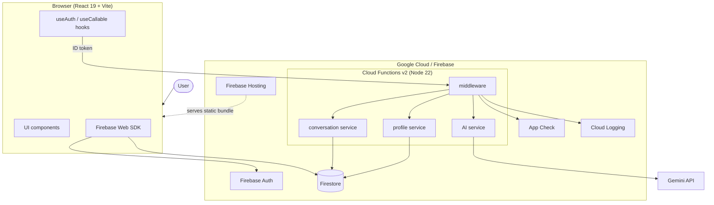
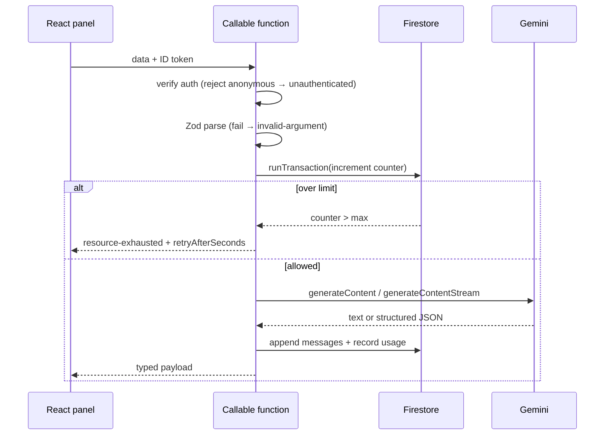
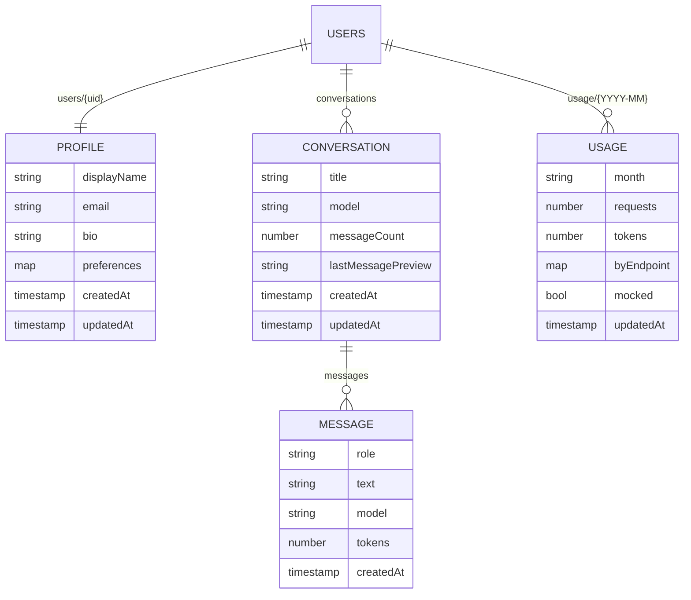

# Architecture

## Goals

1. **No secrets in the browser.** Gemini is callable only through authenticated Cloud Functions.
2. **Predictable cost.** Every request is validated, capped, and rate limited before it reaches the model.
3. **Data ownership by construction.** Firestore paths and rules make cross-user access impossible.
4. **Testable without billing.** Mock mode plus the Emulator Suite reproduce the whole flow locally.

## System context



## Layers

### 1. Web application (`apps/web`)

| Module                 | Responsibility                                                                                                                   |
| ---------------------- | -------------------------------------------------------------------------------------------------------------------------------- |
| `lib/firebase.ts`      | Initialises the SDK, connects emulators when `VITE_USE_EMULATORS=true`, registers App Check when a site key exists               |
| `hooks/useAuth.ts`     | Auth state, sign-up/sign-in/reset/sign-out, profile bootstrap                                                                    |
| `hooks/useCallable.ts` | Wraps `httpsCallable` with loading/error state                                                                                   |
| `components/*`         | Landing, auth panel, prompt panel, chat panel, structured output panel, usage panel, profile panel, setup panel, dashboard shell |
| `lib/env.ts`           | Validates `import.meta.env` and reports which variables are missing                                                              |

The app is intentionally a set of independent panels: delete the ones you do not need and the rest
keeps compiling.

### 2. Functions (`functions/src`)

```
index.ts              registers endpoints, sets global region/instances
config.ts             region, supported models, limits, mock flag, rate-limit config
middleware/
  callable.ts         createCallableHandler: auth → validation → rate limit → handler
  rateLimit.ts        Firestore transaction based fixed-window limiter
validation/schemas.ts Zod input schemas, output schema, JSON schema for Gemini
ai/
  provider.ts         provider factory (gemini | mock)
  gemini.ts           @google/genai client wrapper
  mock.ts             deterministic mock responses
  service.ts          generateText / generateStructuredOutput / sendChatMessage
services/
  conversations.ts    ensureConversation, appendMessage, getRecentMessages, delete
  users.ts            ensureUserProfile, updateUserProfile, recordUsage
endpoints/
  ai.ts               aiGenerateText, aiGenerateStructured, aiChat, aiUsageSummary
  conversations.ts    deleteConversation
  profile.ts          ensureUserProfile, updateUserProfile
  security-demo.ts    secureEcho
  health.ts           apiHealth
utils/
  errors.ts           AppError + HttpsError mapping
  logger.ts           structured logs with redaction
```

### 3. Data layer (`firestore/`)

`firestore.rules` is written as small helpers (`isSignedIn`, `isOwner`, `isServerOnly`) so each rule is
readable and individually testable. `firestore.indexes.json` holds the composite indexes used by the
usage and conversation queries.

## Request lifecycle



## Data model



### Why these shapes

- **Conversations are server-owned.** `aiChat` reads prior turns from Firestore rather than trusting
  `history` from the client; the client payload is only used when a conversation is new.
- **Usage lives per month per user.** One document per month keeps the counter transaction cheap and
  lets the UI render a six-month summary with a single ordered query.
- **`byEndpoint` is a map.** Adding an endpoint does not require a schema migration.

## Failure modes

| Failure                                  | Behaviour                                                             |
| ---------------------------------------- | --------------------------------------------------------------------- |
| Missing auth                             | `unauthenticated` — no model call, no usage write                     |
| Invalid payload                          | `invalid-argument` with the first Zod issue path                      |
| Rate limit exceeded                      | `resource-exhausted` with `retryAfterSeconds` in `details`            |
| Gemini error / timeout                   | `unavailable` for 5xx/timeout, `internal` otherwise; message redacted |
| Structured output invalid                | One repair attempt, then `internal`                                   |
| Firestore write failure after model call | Error surfaced, usage write still attempted in a separate try block   |

## Extension points

- `ai/provider.ts` — add another model vendor behind the `AiProvider` interface.
- `config.ts` — `SUPPORTED_MODELS` controls which model ids pass validation.
- `middleware/callable.ts` — add tracing, feature flags, or per-plan quotas in one place.
